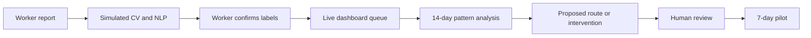

# Ruta Justa Bogotá

An interactive concept prototype connecting frontline waste-picker reporting with biweekly municipal decision support in Bogotá, Colombia.

## Project idea

Ruta Justa separates the product into two connected interfaces:

1. A mobile-first reporting app for waste pickers, community organizations, and volunteers.
2. A desktop decision dashboard for ORO coordinators and UAESP planners.

Frontline reports are classified immediately for operational awareness. Every 14 days, accumulated reports are grouped into recurring patterns and used to generate a proposed collection-route or intervention plan. A human decision-maker must review the proposal before it becomes a seven-day pilot.

## Demo flow



## Interfaces

### Worker app

- Contributor type: waste picker, organization, or volunteer
- Report category and approximate location
- Text, demo voice note, and photo input
- Simulated computer-vision and NLP labels with confidence scores
- Worker confirmation before submission
- Immediate urgent-alert status and biweekly planning status

### Decision dashboard

- Real OpenStreetMap basemap focused on Los Mártires
- Bogotá locality boundary and OSM-derived route geometry
- Current collection route, collection stops, and ECA destination
- Interactive worker-report points with report details and AI confidence
- Live issue counts and urgent-alert queue
- Fourteen-day planning countdown
- Dashed proposed route generated from the current report cycle
- Human review, rejection, and seven-day pilot states

## What is real and what is simulated

The prototype deliberately distinguishes geographic evidence from concept-demo data.

| Component | Status |
|---|---|
| OpenStreetMap basemap | Real |
| Los Mártires boundary | Real geographic geometry |
| Route paths | OSM-derived pedestrian/handcart network proxy |
| Worker reports | Simulated demo records |
| AI image and text classifications | Deterministic simulated inference |
| Biweekly route recommendation | Simulated decision-support output |

This repository demonstrates a product and governance workflow. It is **not** a production routing system and should not be used for operational decisions without validated data, model evaluation, privacy review, and worker consultation.

## Tech stack

- React 19 and TypeScript
- Vinext / Vite with Next-compatible app routing
- Cloudflare Workers
- Cloudflare D1 with Drizzle ORM
- Cloudflare R2 for optional photo uploads
- Leaflet and OpenStreetMap tiles
- Tailwind CSS and custom responsive styles

## Repository structure

```text
app/
  api/
    analysis/        biweekly plan generation and review status
    demo/            idempotent demo-data seed
    photos/          R2 photo delivery
    reports/         report creation and retrieval
  ruta-justa-demo.tsx
db/                  D1 schema and database client
drizzle/             SQL migration and Drizzle metadata
lib/                 shared types and simulated AI logic
public/data/          boundary, route options, points, and OSM paths
worker/               Cloudflare Worker entry point
```

## Run locally

### Requirements

- Node.js 22.13 or newer
- npm

### Install

```bash
npm ci
```

### Build once

The local D1 migration command uses the generated Worker configuration, so build before applying the migration.

```bash
npm run build
```

### Create the local D1 database

```bash
npm run db:migrate:local
```

### Start development

```bash
npm run dev
```

The portable development server normally starts on `http://127.0.0.1:5173`.

## Validation

```bash
npx tsc --noEmit
npm run build
```

## Deployment notes

The full application requires server routes plus D1 and R2 bindings, so it cannot run as a plain GitHub Pages site. Deploy it to a Cloudflare Worker and configure these bindings:

- D1 binding: `DB`
- R2 binding: `BUCKET`

For production, replace the placeholder local D1 database ID and bucket settings in `vite.config.ts` with your Cloudflare resources or deployment configuration. Do not commit API tokens, Git credentials, `.env` files, `.dev.vars`, or local Wrangler state.

## Upload to GitHub

After extracting this ZIP:

```bash
git init
git add .
git commit -m "Initial Ruta Justa Bogotá prototype"
git branch -M main
git remote add origin YOUR_GITHUB_REPOSITORY_URL
git push -u origin main
```

OpenStreetMap data and tiles require appropriate attribution. The application displays `© OpenStreetMap contributors` on the map.
